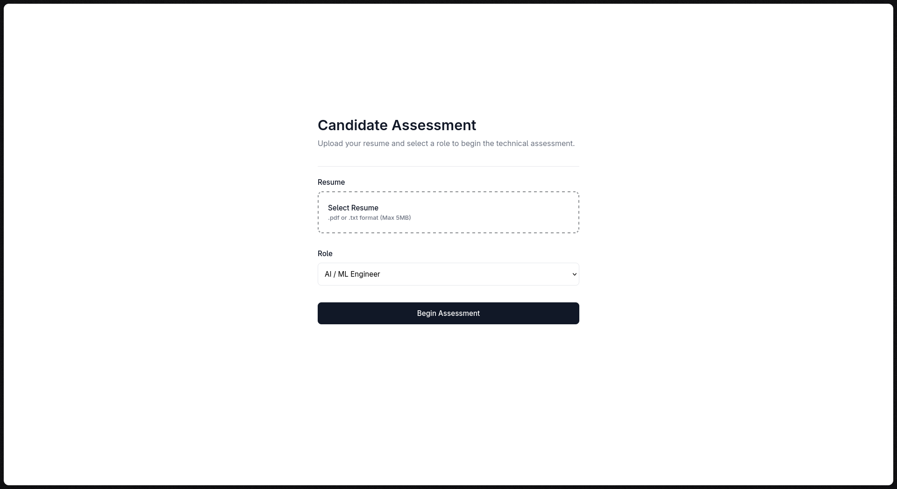
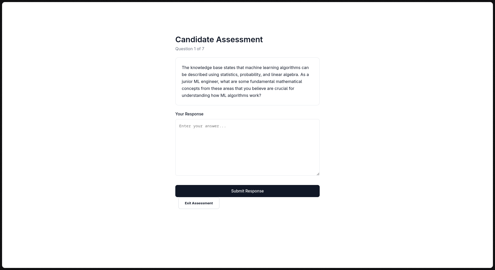
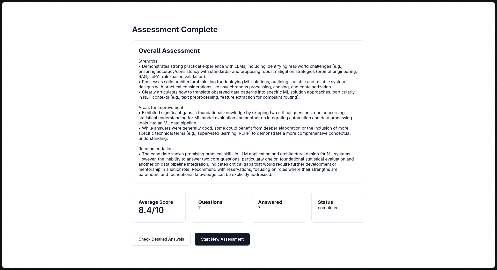
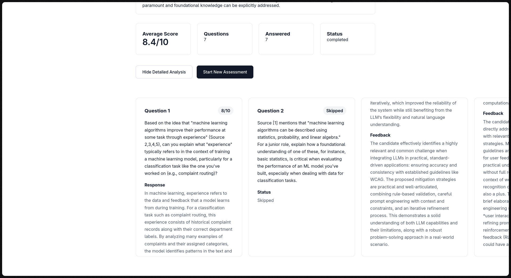

# Candidate Screening AI

AI-powered candidate screening platform that combines Retrieval-Augmented Generation (RAG), resume analysis, dynamic interview generation, and automated technical evaluation to simulate role-specific technical interviews.

---

## Overview

Technical interviews are often generic, repetitive, and difficult to scale consistently across candidates.

Candidate Screening AI addresses this by generating role-specific interview questions grounded in curated technical knowledge bases, adapting them to a candidate's resume, and providing automated evaluation with detailed feedback.

The system parses resumes, retrieves relevant concepts from technical textbooks using a RAG pipeline, generates personalized interview questions, evaluates responses, and produces a structured assessment report.

---

## Demo Video

https://github.com/user-attachments/assets/9552f84c-7be4-4e3b-bbf9-8778034161ab

**Duration:** 1 minute 40 seconds

### Demonstrated Capabilities

* Resume parsing and candidate profiling using Gemini
* RAG-powered retrieval from role-specific knowledge bases
* Personalized interview question generation
* AI-powered answer evaluation and scoring
* Detailed candidate feedback and analysis
* Overall assessment and hiring insights

---

## Screenshots
## Screenshots

<p align="center">
  
  
</p>

<p align="center">
  
  
</p>

---

## Features

### Resume Analysis

* PDF and TXT resume support
* Skill extraction using Gemini
* Domain exposure identification
* Seniority classification (Junior, Mid, Senior)
* Experience summarization

### Retrieval-Augmented Generation

* Role-specific knowledge bases
* ChromaDB vector search
* Multi-query retrieval strategy
* Context-grounded question generation
* Traceability from questions back to source content

### Interview Engine

* Personalized technical assessments
* Dynamic question generation
* Session persistence
* Question skipping support
* Progressive interview flow

### AI Evaluation

* Per-question scoring
* Detailed answer feedback
* Overall assessment generation
* Strengths and improvement areas
* Candidate performance summary

### User Experience

* Professional assessment interface
* Resume upload workflow
* Real-time progress tracking
* Loading states and notifications
* Detailed post-interview analysis

---

## Architecture

```text
┌─────────────────────┐
│   Resume Upload     │
└──────────┬──────────┘
           │
           ▼
┌─────────────────────┐
│  Gemini Parser      │
│  • Skills           │
│  • Domains          │
│  • Seniority        │
└──────────┬──────────┘
           │
           ▼
┌─────────────────────┐
│ Candidate Profile   │
└──────────┬──────────┘
           │
           ▼
┌─────────────────────┐
│ Query Generation    │
└──────────┬──────────┘
           │
           ▼
┌─────────────────────┐
│ ChromaDB Retrieval  │
│     (RAG)           │
└──────────┬──────────┘
           │
           ▼
┌─────────────────────┐
│ Gemini Question     │
│ Generation          │
└──────────┬──────────┘
           │
           ▼
┌─────────────────────┐
│ Technical Interview │
└──────────┬──────────┘
           │
           ▼
┌─────────────────────┐
│ Gemini Evaluation   │
│ • Score             │
│ • Feedback          │
└──────────┬──────────┘
           │
           ▼
┌─────────────────────┐
│ Overall Assessment  │
└──────────┬──────────┘
           │
           ▼
┌─────────────────────┐
│ Results Dashboard   │
└─────────────────────┘
```

---

## Tech Stack

| Layer        | Technology                               |
| ------------ | ---------------------------------------- |
| Frontend     | React 18 + Vite                          |
| Backend      | FastAPI                                  |
| Database     | SQLite + SQLAlchemy 2.0                  |
| LLM          | Google Gemini 2.5 Flash                  |
| Embeddings   | sentence-transformers (all-MiniLM-L6-v2) |
| Vector Store | ChromaDB                                 |
| PDF Parsing  | PyMuPDF                                  |

---

## Project Structure

```text
candidate-screening-ai/
│
├── frontend/
│   ├── public/
│   └── src/
│       ├── pages/
│       │   ├── UploadPage.jsx
│       │   ├── InterviewPage.jsx
│       │   └── ResultsPage.jsx
│       ├── services/
│       │   └── api.js
│       ├── App.jsx
│       └── main.jsx
│
├── backend/
│   ├── .env
│   ├── env.example
│   ├── requirements.txt
│   │
│   ├── api/
│   │   └── routes/
│   │       └── interview.py
│   │
│   └── app/
│       ├── main.py
│       │
│       ├── core/
│       │   ├── config.py
│       │   └── database.py
│       │
│       ├── models/
│       │   └── models.py
│       │
│       ├── schemas/
│       │   └── schemas.py
│       │
│       └── services/
│           ├── resume/
│           │   └── parser.py
│           │
│           ├── rag/
│           │   ├── ingest.py
│           │   ├── retriever.py
│           │   └── question_generator.py
│           │
│           ├── interview/
│           │   └── orchestrator.py
│           │
│           └── evaluation/
│               └── evaluator.py
│
├── knowledge_base/
│   ├── ai_ml/
│   └── backend/
│
└── vector_store/
```

---

## How It Works

### 1. Resume Processing

The candidate uploads a resume.

Gemini extracts:

* Technical skills
* Experience summary
* Domain exposure
* Seniority level

This structured profile becomes the foundation for the rest of the interview.

### 2. Context Retrieval

The system builds multiple retrieval queries using:

* Candidate skills
* Domain experience
* Role selected
* Seniority level

Relevant chunks are retrieved from ChromaDB using locally generated embeddings.

### 3. Question Generation

Retrieved knowledge-base content is combined with resume insights and sent to Gemini.

The model generates a balanced technical assessment consisting of:

* Easy questions
* Medium questions
* Hard questions

All questions are grounded in retrieved context rather than generated from model memory alone.

### 4. Evaluation

Each submitted answer is evaluated independently.

The evaluator generates:

* Numerical score
* Written feedback
* Strengths and weaknesses

At the end of the interview, an overall assessment is generated from all candidate responses.

---

## Setup

### Prerequisites

* Python 3.11+
* Node.js 18+
* Google Gemini API Key

Generate a Gemini API key:

https://aistudio.google.com

---

### Backend Setup

```bash
git clone <repository-url>

cd candidate-screening-ai/backend

uv venv

source .venv/bin/activate
```

Install dependencies:

```bash
uv pip install -r requirements.txt
```

Create environment file:

```bash
cp env.example .env
```

Add your Gemini API key:

```env
GOOGLE_API_KEY=your_api_key_here
```

---

### Knowledge Base Ingestion

Before running the application, ingest the knowledge base.

```bash
python -m app.services.rag.ingest --role ai_ml
```

For backend interview content:

```bash
python -m app.services.rag.ingest --role backend
```

To rebuild the vector database:

```bash
python -m app.services.rag.ingest --role ai_ml --reset
```

---

### Start Backend

```bash
uvicorn app.main:app --reload
```

Backend:

```text
http://localhost:8000
```

Swagger Documentation:

```text
http://localhost:8000/docs
```

---

### Start Frontend

```bash
cd frontend

npm install

npm run dev
```

Frontend:

```text
http://localhost:5173
```

---

## API Endpoints

| Method | Endpoint                                        | Description              |
| ------ | ----------------------------------------------- | ------------------------ |
| POST   | `/sessions`                                     | Create interview session |
| POST   | `/sessions/{id}/resume`                         | Upload resume            |
| GET    | `/sessions/{id}/next-question`                  | Retrieve next question   |
| POST   | `/sessions/{id}/questions/{question_id}/answer` | Submit answer            |
| POST   | `/sessions/{id}/questions/{question_id}/skip`   | Skip question            |
| GET    | `/sessions/{id}/summary`                        | Final assessment report  |

---

## Design Decisions

### Multi-Query Retrieval

A single retrieval query often produces generic results.

Instead, the system generates multiple targeted queries from:

* Skills
* Domains
* Role requirements
* Seniority level

Results are merged and deduplicated to improve context quality.

### Local Embeddings

Embeddings are generated locally using:

```text
all-MiniLM-L6-v2
```

This eliminates embedding API costs and keeps retrieval fast.

### Role-Specific Knowledge Bases

Questions are generated from curated technical resources rather than relying solely on LLM knowledge.

This improves consistency and reduces hallucination.

### Traceability

Every generated question stores:

* Source topics
* Retrieved chunk identifiers

This makes the question generation process explainable and auditable.

### SQLite First

SQLite keeps local development simple and portable.

The architecture can be migrated to PostgreSQL with minimal changes.

---

## Evaluation

Retrieval quality on the `ai_ml` knowledge base, measured with `backend/eval/` (no Gemini calls, fixed synthetic candidate profiles, so it is free and repeatable).

**What is measured.** 30 labelled items. Each is a synthetic candidate profile (skills, domains, seniority) plus the book passages a good interviewer could ground a question in. A retrieved chunk is a hit when it comes from an expected book and contains the expected phrase. Metrics: Hit@k, MRR, and Recall@k (share of an item's expected passages found in the top k).

**Results** (mean over 5 runs per configuration, 2026-10-12, `all-MiniLM-L6-v2`, chromadb 0.5.0):

| chunk size/overlap (chunks) | strategy | Hit@1 | Hit@3 | Hit@5 | Hit@8 | MRR | Recall@5 | Recall@8 |
|---|---|---|---|---|---|---|---|---|
| 500/50 (1447) | `single_concat` | 0.19 | 0.29 | 0.30 | 0.37 | 0.25 | 0.18 | 0.22 |
| 500/50 (1447) | `multi_production` | 0.07 | 0.20 | 0.30 | 0.37 | 0.15 | 0.25 | 0.29 |
| 250/50 (3252) | `single_concat` | 0.10 | 0.30 | 0.37 | 0.40 | 0.20 | 0.21 | 0.23 |
| 250/50 (3252) | `multi_production` | 0.13 | 0.20 | 0.27 | 0.33 | 0.19 | 0.20 | 0.27 |
| 150/30 (5418) | `single_concat` | 0.10 | 0.30 | 0.33 | 0.37 | 0.20 | 0.21 | 0.21 |
| 150/30 (5418) | `multi_production` | 0.03 | 0.13 | 0.27 | 0.43 | 0.14 | 0.18 | 0.31 |

- `single_concat`: one query made of the role, seniority and every skill/domain joined together.
- `multi_production`: the app's real `build_queries_from_resume` + `retrieve_multi`.
- A third baseline that uses only the app's first (role-level) query scored 0.00 on every metric, since that query ignores the resume.
- Hit@8 matters most in practice: the question generator reads the top 8 chunks.
- Full tables with per-run ranges and the items that never hit: `backend/eval/results/retrieval_2026-10-12_48442c75.md`.

**Before and after the retrieval fixes** (default 500/50, same 30 items, same labels):

| | Hit@5 | Hit@8 | Recall@8 | duplicate chunks in top 8 |
|---|---|---|---|---|
| `multi_production`, before | 0.23 | 0.23 | 0.16 | 0.19 |
| `multi_production`, after | 0.30 | 0.37 | 0.29 | 0.00 |
| `single_concat`, before | 0.11 | 0.21 | 0.13 | 0.18 |
| `single_concat`, after | 0.30 | 0.37 | 0.22 | 0.00 |

The fixes were applied together, so the gain cannot be split between them: (1) removed the duplicate PDF `Advanced ML2.pdf` (byte-identical to `AIML1.pdf`), (2) indexed only each book's body pages and skipped covers, contents, prefaces, references and indexes (`BODY_PAGES` in `ingest.py`), (3) de-duplicated merged results by text instead of chunk id, (4) cached the embedding model. The earlier results are kept in `backend/eval/results/retrieval_2026-10-12_22d49e78.md`.

**What the numbers say.**
- Retrieval is still modest: at most 37% of items find an expected passage in the top 5, at any setting.
- Multi-query is **not** clearly better than one combined query. At 500/50 the two tie on Hit@5 and Hit@8. Multi-query finds more of an item's expected passages (Recall@8 0.29 vs 0.22) but ranks the first correct one lower (MRR 0.15 vs 0.25). At 250/50 the single query is ahead; at 150/30 multi-query is ahead on Hit@8 only. With 30 items, one item is 0.03, so differences of a few hundredths are noise.
- No chunk setting is a clear winner for the production strategy (`multi_production` Hit@8: 0.37, 0.33, 0.43). The production chunk size was not changed.

**Caveats.**
- Small set (30 items), one knowledge base, one embedding model.
- The profiles and labels were drafted by an AI assistant from the book text and are being reviewed by the project author; anchor phrases are verified to exist in the PDFs (`python -m eval.validate_labels`), but whether each label is the right one is a judgement call.
- Labels are strict: several books cover the same topic and only the listed passages count, so some genuinely relevant chunks are scored as misses.
- Page ranges in `BODY_PAGES` were chosen by inspecting each book; a wrong range would hide real content. `eval/tests` checks they lie inside each PDF, not that they are right.
- Chroma's approximate nearest-neighbour search returned slightly different top-8 lists in different processes on the same index; hence the 5-run means.

**Reproduce.**

```bash
cd backend
python -m eval.run_retrieval            # all three chunk configs, 5 runs each (first run builds indexes, slow)
python -m eval.run_retrieval --configs 500/50 --repeats 3
python -m eval.validate_labels --review # check anchors, write eval/labels_review.md
python -m pytest eval/tests             # metric and label-schema tests
```

---

## Environment Variables

| Variable           | Description                |
| ------------------ | -------------------------- |
| GOOGLE_API_KEY     | Gemini API key             |
| GOOGLE_MODEL       | Gemini model               |
| DATABASE_URL       | Database connection string |
| CHROMA_PERSIST_DIR | ChromaDB storage location  |
| KNOWLEDGE_BASE_DIR | Knowledge base directory   |
| EMBEDDING_MODEL    | Embedding model            |
| CHUNK_SIZE         | Retrieval chunk size       |
| CHUNK_OVERLAP      | Chunk overlap              |
| RETRIEVAL_TOP_K    | Number of retrieved chunks |

---

## Future Improvements

* Voice-based interviews
* Resume vs Job Description matching
* Recruiter dashboard
* PDF assessment exports
* Authentication and user accounts
* Additional engineering roles
* PostgreSQL deployment
* Cloud-hosted vector database

---

## Author

Built by Nishik Varma as a practical exploration of applied AI systems involving RAG, LLM orchestration, vector search, and automated technical assessment.
